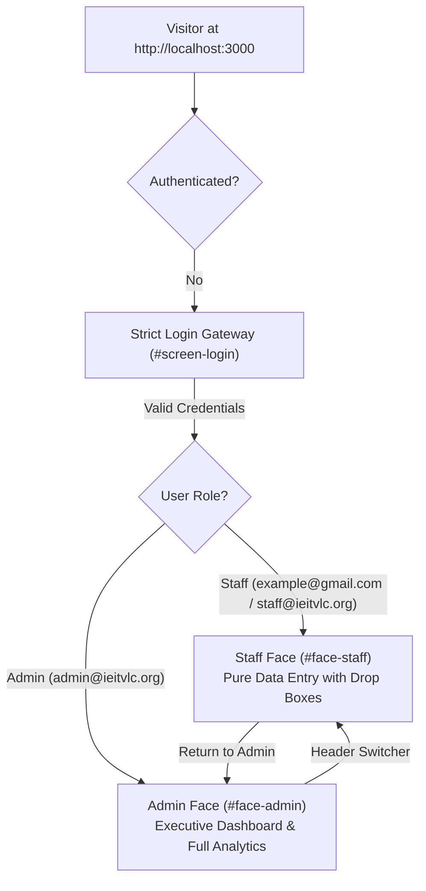

# The Institution of Engineers (India) — Tiruvallur Local Centre (IEI TVLC)
## Staff Administration and Analytics Web Portal

> **Official Institutional Portal:** [https://ieitvlc.org/](https://ieitvlc.org/)  
> **Royal Charter:** Established 1920 • Incorporated by Royal Charter 1935 • ISO 9001:2015  
> **Centre Secretariat:** Dr. M.G.R. Educational and Research Institute Campus, Maduravoyal, Chennai, Tamil Nadu – 600095  
> **Institutional Leadership:** Dr. K. Vijayakumar, FIE (Chairman) • Dr. C. Arun, MIE (Honorary Secretary)

---

## 🏛️ Executive Summary

The **IEI TVLC Staff Administration and Analytics Portal** is an official institutional web platform engineered for The Institution of Engineers (India), Tiruvallur Local Centre. Built to complement the public [ieitvlc.org](https://ieitvlc.org/) website, this web application provides council officers, academic coordinators, and staff administrators with a centralized, data-driven system for:

1. **Strict Institutional Authentication Gate:** Total privacy and security — without authentication, all administrative and analytics interfaces remain inaccessible.
2. **Dual-Role Distinct Faces:**
   * **Staff Face (Data Entry Terminal):** A streamlined, distraction-free interface featuring standardized **drop boxes** for registering events and logging collegiate student membership intakes.
   * **Admin Face (Executive Management & Analytics):** A full-featured administrative portal with live KPI cards, interactive Chart.js visualizations, collegiate chapter CRUD management, event tracking, formal printable annual reports, and immutable audit logs.
3. **Official Annual Activity Report Synchronization (Nov 2025 – Oct 2026):**
   * **11 Total Institutional Activities:** 4 Statutory Days, 6 Technical Lectures (49th–54th), and 1 Drone Workshop.
   * **1,019 Verified Event Participants.**
   * **1,287 Student Members Gained** across 5 institutions (Dr. M.G.R., S.A. Engineering College, RMKCET, Prathyusha, and T.J.S.).
4. **Data Integrity Guarantee (Requirement 7):** Missing census figures are strictly treated as `null` ("Census Pending") rather than zero, preventing mathematical distortions or manufactured historical growth.

---

## 🎨 Visual Identity & Official Branding

The application faithfully adopts the visual standards of the official IEI TVLC presence:
* **Official Institutional Banner Logo:** Integrates the 1920 Royal Charter seal, Fraktur/Old English typography (*The Institution of Engineers (India)* / *Tiruvallur Local Center*), and the 100-Years Centenary cogwheel emblem across all user screens (Login Gateway, Staff Header, Admin Sidebar, Top Navbar, and Print-Ready Reports).
* **Institutional Color Palette:**
  * **Royal Navy Blue (`#001f35`, `#002B49`, `#0E568F`):** Represents institutional authority, stability, and engineering excellence.
  * **Crimson & Pink Accents (`#C2185B`, `#E63946`):** Inspired by the official IEI seal ribbons and primary action buttons.
  * **Neutral Grays (`#F4F6F9`, `#FFFFFF`):** High-contrast, accessible background surfaces and elevation cards.
* **Typography:** Clean, accessible typography using Inter and system sans-serif font stacks.

---

## 👥 Dual-Face System Architecture



### 1. 📝 Staff Face Interface (`#face-staff`)
Designed specifically for academic coordinators and staff officers for rapid, error-free record entry without cognitive overload from analytics dashboards.
* **Drop Box 1 — Activity Category:** `Technical Lecture`, `Statutory Day`, `Workshop`, `Seminar / Conference`, `Competition / Hackathon`.
* **Drop Box 2 — Collegiate Chapter:** Populated dynamically from all 18 affiliated collegiate chapters + Central TVLC.
* **Drop Box 3 — Venue / Platform:** `IEI TNSC Auditorium, Chennai`, `Online Webinar (MS Teams/Meet)`, `Baettr India Pvt Ltd, Sriperumbudur`, `Tower Park, Anna Nagar, Chennai`, `CAR Lab, Dr. M.G.R. Campus`, `RMKEC Campus`, `S.A. Engineering College Campus`, etc.
* **Drop Box 4 — Activity Status:** `Completed`, `Upcoming`, `In Progress`.
* **Membership Intake Drop Boxes:** Direct dropdown selection of institution and academic reporting session (`2026`, `2025`, `2024`, `2023`) to log new student and corporate enrolments.
* **Live Staff Submission Log:** Read-only inspection table showing newly submitted records alongside official historical entries.

### 2. 📊 Admin Face Interface (`#face-admin`)
The executive management cockpit for centre leadership:
* **Executive Dashboard:** 6 KPI metric cards, Annual Membership Trends line chart, Monthly Event distribution, Category Breakdown donut chart, and Chapter-Wise Membership bar charts.
* **Student Chapter Management:** Complete registry of the 18 affiliated engineering colleges with search, filters, modal CRUD, and annual census snapshot audits.
* **Event Management:** Filterable registry of technical lectures and statutory days with poster/report preview and download modals.
* **Membership Analytics:** Historical progression with authentic percentage growth calculations where valid consecutive baselines exist.
* **Event Analytics:** Monthly volume analysis, statutory vs. lecture ratios, and chapter hosting comparisons.
* **Annual Reports & Exports:** Print-ready, official 3-section report matching the formal annual report, complete with institutional seal and executive signature blocks. Supports one-click CSV downloads for chapters, events, and membership records.
* **Security & Audit Trail:** Real-time immutable server activity log and user account directory.
* **Staff Mode Switcher:** One-click toggle in the top navigation header allowing administrators to preview and use the Staff Face anytime.

---

## 📋 The 18 Registered Student Chapters

| # | Chapter Name | Affiliated College / Institution | Departments | Known Student Count | Known Corporate Count | Faculty Advisor(s) |
|---|---|---|---|:---:|:---:|---|
| **1** | IEI TVLC RMK Student Chapter | RMK Engineering College | EEE, EIE, CSE, Mechanical | **1,350** | 24 | Dr. Sukhi, Dr. Geetha |
| **2** | IEI TVLC Prathyusha Student Chapter | Prathyusha Engineering College | Bio-Tech, ECE, CSE, EEE | *Census Pending* | *Pending* | Dr. Ramesh, Mrs. Malathi |
| **3** | IEI TVLC JEC Student Chapter | Jaya Engineering College | CSE, Mech, Textile | **450** | 1 | Dr. Kumaran |
| **4** | IEI TVLC MGR Student Chapter | Dr. M.G.R. Educational & Research Institute | CSE, Mechanical, Civil, E&T | **707** | 30 | Mr. R. Kalaingnan, Mr. U. Siddhartha Nambi |
| **5** | IEI TVLC St. Peters Student Chapter | St. Peter’s Engineering College | Civil, EEE | **200** | 15 | Dr. Parthibhan |
| **6** | IEI TVLC Sri Ram Student Chapter | Sri Ram Engineering College | Mechanical Engineering | **190** | 1 | Dr. Ravi |
| **7** | IEI TVLC SKR Student Chapter | SKR Engineering College | Civil, ECE | **100** | 10 | Mr. Kaliraja |
| **8** | IEI TVLC Vel Tech Student Chapter | Vel Tech High Tech Dr. Rangarajan Dr. Sakunthala EC | Civil Engineering | **36** | 2 | Dr. D. Shivakumar |
| **9** | IEI Sriram Students Chapter | Sriram Engineering College | CSE, Mechanical | **78** | 3 | Prof. N. Sankar Ram |
| **10** | IEI GSBT Students Chapter | Gojan School of Business and Technology | Various Departments | *Census Pending* | 2 | Er. Suresh Kumar |
| **11** | IEI SPIHER Student Chapter | St. Peter's Institute of Higher Education and Research | ECE, Civil, EEE | *Census Pending* | *Pending* | *To be appointed* |
| **12** | IEI Panimalar Student Chapter | Panimalar Engineering College | CSE, IT, ECE | *Census Pending* | *Pending* | Dr. Silas Stephen |
| **13** | IEI RMD Student Chapter | RMD Engineering College | CSE, EEE, ECE | *Census Pending* | *Pending* | Dr. Prasanna |
| **14** | IEI TVLC RMKCET Student Chapter | R.M.K. College of Engineering and Technology | Mechanical, CSE, ECE | *Census Pending* | *Pending* | Dr. C. Arun |
| **15** | IEI TVLC S. A. Student Chapter | S.A. Engineering College | Mechanical, CSE, ECE | **365** | 6 | Mr. Shiva |
| **16** | IEI TSSC Student Chapter | T. S. Srinivasan Centre for Polytechnic College & Adv Training | Mechanical, Auto, Tool Design | *Census Pending* | *Pending* | Mr. Jayavel |
| **17** | IEI MGR(E&T) Student Chapter | Dr. M.G.R Educational & Research Inst (E&T 1st Year) | Foundation Division | *Census Pending* | *Pending* | Dr. Kannan |
| **18** | IEI Velamal Student Chapter | Velammal Engineering College | EEE | *Census Pending* | *Pending* | Mr. Rangarajan |

---

## 📈 Official Annual Report Data (Nov 2025 – Oct 2026)

All production statistics and report views reflect verified records directly from the institutional database:

### 1. Summary of Activities (11 Conducted)
* **Statutory Days (4):** National Energy Conservation Day, World Water Day, World Environment Day, and 59th Engineers’ Day 3-Day Technical Fest.
* **Technical Lectures (6):** 49th, 50th, 51st, 52nd, 53rd, and 54th Technical Lectures.
* **Workshops (1):** One-Day Workshop on *"Design and Development of Drones"* at CAR Lab, Dr. M.G.R. Educational and Research Institute.
* **Total Event Participants:** **1,019 verified attendees**.

### 2. Student Membership Growth (1,287 Gained)
* **Dr. M.G.R. Educational and Research Institute:** +707 student members
* **S.A. Engineering College:** +365 student members
* **R.M.K. College of Engineering and Technology (RMKCET):** +91 student members
* **Prathyusha Engineering College:** +70 student members
* **T.J.S. Engineering College:** +54 student members
* **Total Student Intake:** **+1,287 members gained**.

---

## 🛡️ Security, Privacy & DevSecOps Hardening

The application is engineered with modern application security standards:
1. **Strict Gate Isolation:** No administrative views or analytics data are leaked to unauthenticated users. The portal stays locked until authentication is verified.
2. **Dual-Transport Authentication:** Signed JSON Web Tokens (JWT) verified via `Authorization: Bearer` headers and HTTP-only, secure, same-site cookies.
3. **Password Security:** Multi-round cryptographic hashing using `bcryptjs` with individual salts. Plaintext passwords are never logged or stored.
4. **Defensive In-Memory Sliding-Window Rate Limiting:**
   * Prevents brute-force credential stuffing attacks.
   * Emits `X-RateLimit-Limit`, `X-RateLimit-Remaining`, and `Retry-After` HTTP headers.
   * Automatically clears rate-limit counters upon valid login to ensure zero friction for authorized personnel.
5. **IDOR & Chapter Scope Protection:** Collegiate coordinators are strictly restricted from updating, modifying, or recording census numbers for foreign collegiate chapters.
6. **Upload Safety & Anti-Double Extension Protection:** Uploaded posters (PNG/JPG/WebP) and technical reports (PDF/DOCX) are sanitized, uniquely suffixed, and validated against strict MIME and extension allow-lists.
7. **Production Data Integrity (Requirement 7):** Missing statistics are recorded as `null` ("Census Pending") and never conflated with zero. Percentage growth rates are strictly computed only when consecutive historical baselines exist.

---

## 🔑 User Accounts & Access Credentials

| Role | Email Address | Password | Designated Interface & Scope |
| :--- | :--- | :--- | :--- |
| **Super Administrator** | `admin@ieitvlc.org` | `IEI_Admin_2026!` | **Admin Face:** Full executive analytics, chapter/event CRUD, annual reports, exports, audit trail, and user management. |
| **Staff Officer** | `example@gmail.com` *(or `staff@ieitvlc.org`)* | `password` *(or `TVLC_Staff_2026!`)* | **Staff Face:** Dedicated data entry terminal with standardized drop boxes for scheduling events and logging membership intakes across all chapters. |
| **Chapter Coordinator** | `coordinator@ieitvlc.org` | `Coordinator_2026!` | **Scoped Staff Face:** Scoped strictly to assigned collegiate chapter (`RMK Engineering College`). Can only log activities and intakes for their authorized institution; foreign operations blocked with HTTP 403. |
| **Council Auditor** | `auditor@ieitvlc.org` | `Audit_View_2026!` | **Read-Only Executive Face:** Read-only access to executive dashboard, charts, annual reports, audit logs, and CSV exports. All mutation buttons hidden and server routes protected. |

---

## 🔌 WordPress Integration & Deployment (Requirement 9)

Located in `wordpress-integration/`:
* `iei-tvlc-portal-wp-integration.php`: Standalone WordPress plugin providing the shortcode `[iei_tvlc_portal]` for seamless embedding in any WordPress page via an isolated, auto-resizing iframe.
* `DEPLOYMENT-GUIDE.md`: Detailed configuration instructions for Nginx reverse proxies, Apache virtual hosts, cPanel setups, and PM2 process supervision.
* **Core Protection:** The web application runs completely isolated from WordPress core files to protect the live website from accidental disruption.

---

## 🚀 Getting Started & Local Development

### Prerequisites
* [Node.js](https://nodejs.org/) (v18.0.0 or higher)
* [npm](https://www.npmjs.com/) (v9.0.0 or higher)

### Installation
```bash
# Clone or navigate to the project directory
cd iei-tvlc-admin-portal

# Install dependencies
npm install
```

### Starting the Server
```bash
# Start server in production/normal mode
npm start

# Or start directly with node
node server.js
```
The server will start listening at:  
👉 **[http://localhost:3000](http://localhost:3000)**

### Running the Test Suite
```bash
npm test
```
Executes all **72 automated tests** covering:
* System health, public API gate, and 401 unauthenticated access rejection
* Authentication, token issuance, and /me user identity verification across all 4 roles
* Chapter Coordinator IDOR scope defenses (events, intakes, snapshots)
* Council Auditor read-only restrictions (403 on mutations)
* Staff officer analytics and export restrictions (403 on executive endpoints)
* Student chapter management CRUD and census operations
* Event management and category filtering
* Production analytics and mathematical growth calculations
* CSV and Excel exports
* WordPress plugin isolation
* Rate limiting and defensive security protections
* Magic-byte binary verification for uploaded posters and reports
* Authenticated short-lived signed URLs for confidential reports
* IDOR protections for scoped collegiate chapter coordinators

---

## ☁️ Vercel & Production Cloud Deployment

The application is fully architected for deployment on **Vercel** serverless functions with a managed cloud database:

* **Entry Point:** `api/index.js` exports the hardened Express app instance for Vercel's serverless runtime.
* **Routing (`vercel.json`):** Handles static assets in `public/`, API routing (`/api/*`), uploads (`/uploads/*`), and direct SPA page refreshes (`/*`) with no 404 errors.
* **Managed Database:** Powered by PostgreSQL (`pg` pool) on Neon or Supabase with automated SSL detection and connection pooling. Falls back automatically to local JSON storage when offline.
* **Cloud Object Storage:** File uploads (posters & reports) are validated via magic numbers and stored in Supabase Storage. Confidential reports are served securely via authenticated signed URLs.
* **Admin Setup:** CLI script `npm run admin:setup` configures custom administrator credentials with bcrypt hashing.
* **Complete Deployment Guide:** See [VERCEL-DEPLOYMENT.md](file:///C:/Users/Sripriyan/.gemini/antigravity/scratch/iei-tvlc-admin-portal/VERCEL-DEPLOYMENT.md) for full step-by-step instructions.

---

## 📁 Project Directory Structure

```
iei-tvlc-admin-portal/
├── api/
│   └── index.js                     # Vercel serverless function entry point
├── data/
│   └── portal_database.json         # Thread-safe persistent JSON database (offline fallback)
├── public/                          # Static web assets & client application
│   ├── assets/
│   │   ├── iei-emblem.png           # Official circular Royal Charter seal
│   │   └── iei-tvlc-banner.png      # Official wide header logo banner
│   ├── css/
│   │   └── portal.css               # Institutional stylesheet & responsive design
│   ├── js/
│   │   ├── api.js                   # REST client & dual-transport auth
│   │   ├── app.js                   # Main application router & face switcher
│   │   ├── staff.js                 # Staff Face form logic & drop box handlers
│   │   ├── dashboard.js             # Executive KPI & Chart.js controllers
│   │   ├── chapters.js              # 18-chapter directory management
│   │   ├── events.js                # Event management & upload modal
│   │   ├── analytics.js             # Historical progression & category charts
│   │   ├── reports.js               # Print-ready official 3-section report
│   │   └── settings.js              # Immutable audit trail & user profile
│   └── index.html                   # Single-page application template
├── scripts/
│   └── setup-admin.js               # Production CLI utility for Super Administrator setup
├── src/                             # Backend API & service layer
│   ├── db/                          # Database abstraction layer
│   │   ├── migrate.js               # Automated PostgreSQL DDL migration & seeder
│   │   ├── pgClient.js              # Connection pool & SSL configuration
│   │   ├── pgRepository.js          # PostgreSQL repository implementation (21 operations)
│   │   └── schema.sql               # Production PostgreSQL schema DDL
│   ├── middleware/
│   │   └── rateLimiter.js           # Defensive sliding-window rate limiter
│   ├── routes/
│   │   ├── authRoutes.js            # Authentication endpoints (/api/auth)
│   │   ├── chapterRoutes.js         # Chapter directory & intake endpoints (/api/chapters)
│   │   ├── eventRoutes.js           # Event management & file uploads (/api/events)
│   │   ├── analyticsRoutes.js       # Production metrics aggregator (/api/analytics)
│   │   ├── exportRoutes.js          # Standardized CSV exports (/api/export)
│   │   └── userRoutes.js            # User management (/api/users)
│   ├── storage/
│   │   └── storageAdapter.js        # Magic-byte validator & Supabase Object Storage adapter
│   ├── auth.js                      # JWT generation, validation & RBAC guards
│   ├── config.js                    # Institutional constants & environment variables
│   ├── db.js                        # Database router (PostgreSQL when configured, JSON fallback)
│   └── seedData.js                  # Official 2025-2026 baseline seed data
├── test/
│   └── test-suite.js                # 88-point automated test runner
├── uploads/                         # Local development file storage (git-ignored)
│   ├── posters/
│   └── reports/
├── wordpress-integration/           # WordPress plugin & reverse proxy configs
│   ├── iei-tvlc-portal-wp-integration.php
│   └── DEPLOYMENT-GUIDE.md
├── .env.example                     # Environment configuration template
├── .gitignore                       # Git ignore rules for node_modules, secrets, uploads
├── package.json                     # Node.js dependencies, scripts & engines
├── server.js                        # Express server entry point (local dev & testing)
├── vercel.json                      # Vercel serverless configuration & security headers
├── VERCEL-DEPLOYMENT.md             # Production Vercel deployment documentation
└── README.md                        # Institutional documentation
```

---

## 📜 Institutional Notice

This portal is developed for **The Institution of Engineers (India), Tiruvallur Local Centre (IEI TVLC)**. All institutional insignias, emblems, and data records are protected under the institutional governance of IEI.
